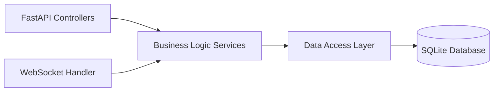
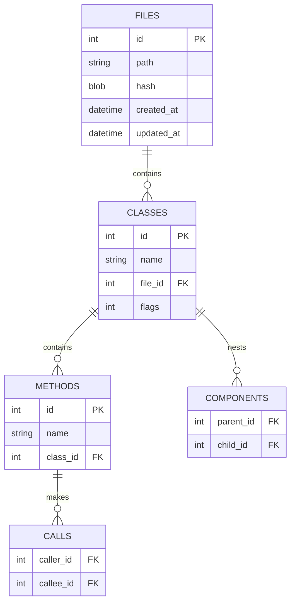

# 动态更新版 ArkTS→SQLite 代码知识图谱系统 - 技术架构文档

## 1. Architecture Design

```mermaid
graph TB
    subgraph "Frontend (React + TypeScript)"
        A[KnowledgeGraphVisualizer]
        B[SystemArchitectureViewer]
        C[ProcessSequenceDiagram]
        D[RealTimeStatusMonitor]
        E[NaturalLanguageQuery]
    end
    
    subgraph "Backend (Python + FastAPI)"
        F[FileMonitorService]
        G[ChangeQueueManager]
        H[ArkTSAnalyzer]
        I[SQLiteDatabase]
        J[LLMQueryHandler]
    end
    
    subgraph "External Services"
        K[SiliconFlow LLM API]
    end
    
    subgraph "Database"
        L[(SQLite Database]
    end
    
    A &lt;--&gt;|WebSocket| F
    B &lt;--&gt;|REST API| F
    C &lt;--&gt;|REST API| F
    D &lt;--&gt;|WebSocket| F
    E &lt;--&gt;|REST API| J
    F --&gt; G
    G --&gt; H
    H --&gt; I
    I --&gt; L
    J --&gt; K
    J --&gt; I
```

## 2. Technology Description

- **前端: React@18 + TypeScript + Vite + Tailwind CSS
- **初始化工具**: vite-init
- **后端**: Python 3.11 + FastAPI
- **数据库**: SQLite
- **图表库**: ReactFlow / D3.js
- **文件监控**: watchdog
- **LLM 集成**: SiliconFlow API

## 3. Route Definitions

| Route | Purpose |
|-------|---------|
| / | Home page with navigation to all features |
| /graph | Knowledge graph visualization |
| /architecture | System architecture diagram |
| /process | Process &amp; sequence diagrams |
| /status | Real-time update status |
| /query | Natural language query |
| /api/files | Get all files metadata |
| /api/files/:id | Get file details |
| /api/classes | Get all classes |
| /api/methods | Get all methods |
| /api/calls | Get call relationships |
| /api/components | Get component nesting |
| /api/query | Natural language query endpoint |
| /ws/status | WebSocket for real-time status updates |

## 4. API Definitions

### Type Definitions

```typescript
interface File {
  id: number;
  path: string;
  hash: string;
  createdAt: string;
  updatedAt: string;
}

interface Class {
  id: number;
  name: string;
  fileId: number;
  flags: number;
}

interface Method {
  id: number;
  name: string;
  classId: number;
}

interface CallRelationship {
  callerId: number;
  calleeId: number;
}

interface ComponentRelationship {
  parentId: number;
  childId: number;
}

interface QueryRequest {
  question: string;
}

interface QueryResponse {
  sql: string;
  result: any[];
}

interface StatusUpdate {
  type: 'file_changed' | 'sync_progress' | 'queue_updated';
  payload: any;
}
```

## 5. Server Architecture Diagram



## 6. Data Model

### 6.1 Data Model Definition



### 6.2 Data Definition Language

```sql
-- 核心表结构
CREATE TABLE IF NOT EXISTS files (
    id INTEGER PRIMARY KEY AUTOINCREMENT,
    path TEXT UNIQUE NOT NULL,
    hash BLOB NOT NULL,
    created_at DATETIME DEFAULT CURRENT_TIMESTAMP,
    updated_at DATETIME DEFAULT CURRENT_TIMESTAMP
);

CREATE TABLE IF NOT EXISTS classes (
    id INTEGER PRIMARY KEY AUTOINCREMENT,
    name TEXT NOT NULL,
    file_id INTEGER NOT NULL,
    flags INTEGER DEFAULT 0,
    FOREIGN KEY (file_id) REFERENCES files(id) ON DELETE CASCADE
);

CREATE TABLE IF NOT EXISTS methods (
    id INTEGER PRIMARY KEY AUTOINCREMENT,
    name TEXT NOT NULL,
    class_id INTEGER NOT NULL,
    FOREIGN KEY (class_id) REFERENCES classes(id) ON DELETE CASCADE
);

CREATE TABLE IF NOT EXISTS calls (
    caller_id INTEGER NOT NULL,
    callee_id INTEGER NOT NULL,
    PRIMARY KEY (caller_id, callee_id),
    FOREIGN KEY (caller_id) REFERENCES methods(id) ON DELETE CASCADE,
    FOREIGN KEY (callee_id) REFERENCES methods(id) ON DELETE CASCADE
);

CREATE TABLE IF NOT EXISTS components (
    parent_id INTEGER NOT NULL,
    child_id INTEGER NOT NULL,
    PRIMARY KEY (parent_id, child_id),
    FOREIGN KEY (parent_id) REFERENCES classes(id) ON DELETE CASCADE,
    FOREIGN KEY (child_id) REFERENCES classes(id) ON DELETE CASCADE
);

-- 创建索引
CREATE INDEX IF NOT EXISTS idx_classes_file_id ON classes(file_id);
CREATE INDEX IF NOT EXISTS idx_methods_class_id ON methods(class_id);
```
