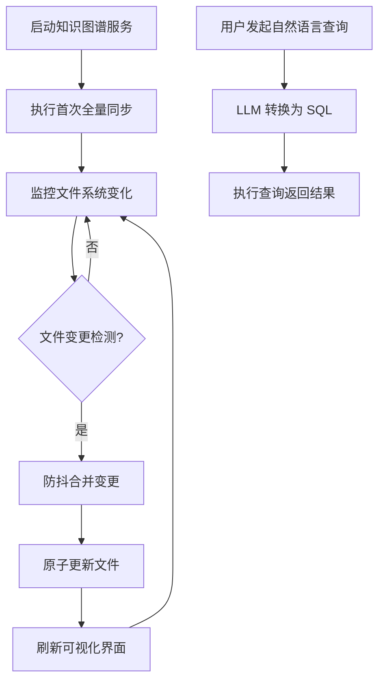

# 动态更新版 ArkTS→SQLite 代码知识图谱系统 - 产品需求文档

## 1. Product Overview
动态更新版 ArkTS 代码知识图谱系统，实时解析鸿蒙项目 .ets 源文件，构建完整的代码结构知识图谱并持久化到 SQLite。提供可视化界面展示架构图、流程图、时序图等，支持自然语言查询。
- 核心问题：传统静态代码分析工具更新慢、缺乏实时性、难以直观理解复杂项目
- 目标用户：鸿蒙应用开发者、技术架构师、代码维护人员

## 2. Core Features

### 2.1 Feature Module
1. **知识图谱可视化页面**：项目结构树、代码调用关系图、组件嵌套关系
2. **系统架构图页面**：展示系统整体架构、模块关系
3. **流程与时序图页面**：展示动态更新流程、文件处理时序
4. **实时更新状态页面**：显示文件监控状态、变更队列、同步进度
5. **自然语言查询页面**：支持用自然语言查询数据库知识

### 2.3 Page Details
| Page Name | Module Name | Feature description |
|-----------|-------------|---------------------|
| Knowledge Graph Visualization | Project Structure Tree | 可展开/折叠的项目文件树，显示 .ets 文件及其类、方法 |
| | Call Graph | 交互式有向图展示方法调用关系，支持点击查看详情 |
| | Component Nesting Tree | 展示组件的父子嵌套结构 |
| System Architecture Diagram | Architecture Overview | 分层架构图：前端→后端→数据库→外部服务 |
| | Module Relationship | 核心模块之间的依赖关系可视化 |
| Process & Sequence Diagram | Update Workflow | 完整的文件更新流程流程图 |
| | File Processing Timeline | 单个文件更新的详细时序图 |
| Real-time Update Status | File Monitor Status | 文件系统监控器运行状态 |
| | Change Queue | 显示待处理的变更队列 |
| | Sync Progress | 同步进度条和统计信息 |
| Natural Language Query | Query Interface | 文本输入框，支持自然语言提问 |
| | Query Result | 显示 SQL 转换结果和查询数据 |

## 3. Core Process
主要用户流程：启动服务 → 执行首次全量同步 → 查看知识图谱 → 修改源代码文件 → 系统自动检测并更新 → 查看更新后的图谱 → 自然语言查询。

## 4. User Interface Design
### 4.1 Design Style
- 主色调：深科技蓝 (#1a365d) + 科技绿 (#2dd4bf)
- 配色方案：深色背景 (#0f172a) + 浅色文字 (#f1f5f9) + 强调色 (#38bdf8)
- 按钮风格：圆角矩形，带微妙阴影和悬停效果
- 字体：JetBrains Mono 用于代码展示，Inter 用于界面文本
- 布局风格：基于卡片的分栏布局，顶部导航栏
- 图标：Lucide 图标库，线条风格

### 4.2 Page Design Overview
| Page Name | Module Name | UI Elements |
|-----------|-------------|-------------|
| Knowledge Graph Visualization | Project Structure Tree | 侧边栏，可折叠树形结构，深色背景 |
| | Call Graph | 主区域，力导向图，节点带颜色和标签 |
| System Architecture Diagram | Architecture Overview | 中心区域，分层可视化，连接线 |
| Process & Sequence Diagram | Update Workflow | 流程图，高亮状态变化 |
| | File Processing Timeline | 垂直时序图，时间轴从左到右 |
| Real-time Update Status | File Monitor Status | 状态指示器，绿色/红色显示运行状态 |
| | Change Queue | 滚动列表，显示待处理文件 |
| | Sync Progress | 进度条，百分比显示 |
| Natural Language Query | Query Interface | 大文本输入框，发送按钮 |
| | Query Result | 表格/JSON 视图，支持导出 |

### 4.3 Responsiveness
桌面优先，自适应窗口大小。侧边栏可折叠，图表区域响应式缩放。
